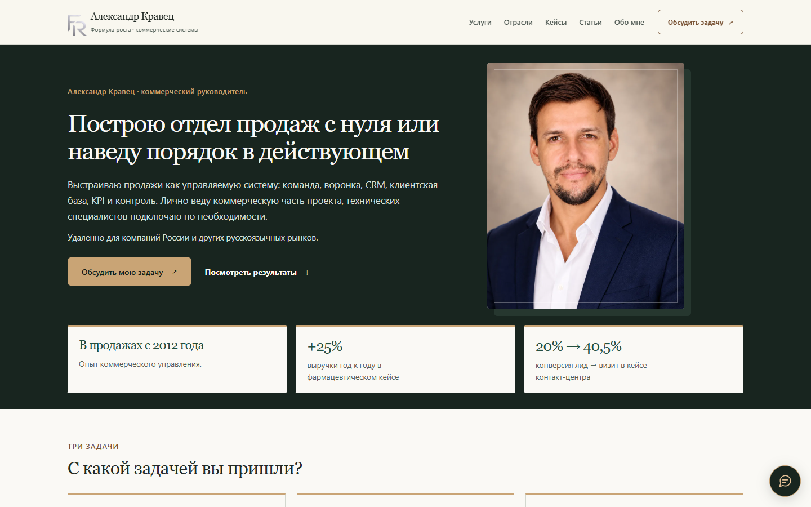
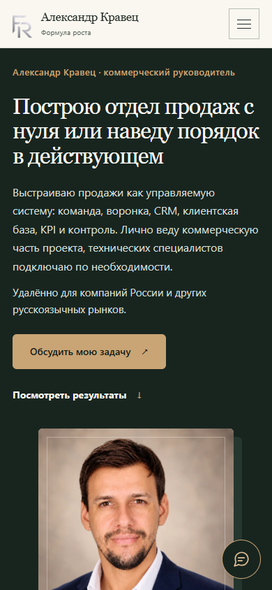

# Главная: три понятных сценария работы — 27 октября 2026

База: `main` / `8b9ceb20fba31b654445db9b867ea2479451e4dc`. Ветка: `codex/homepage-three-scenarios`. Публикация и слияние не выполняются до утверждения владельцем.

## Что изменилось

Первый экран использует заданные H1, лид, подпись и пояснение об удалённой работе. Основная кнопка «Обсудить мою задачу» открывает действующее окно мессенджеров; «Посмотреть результаты» ведёт к кейсам.

Вместо длинной последовательности проблем, семи равнозначных услуг и шести сравнений процессов показаны три задачи: создать отдел продаж, усилить действующий отдел и подключить внешнего РОПа. Ссылки ведут соответственно на построение отдела, аудит и внешнее управление. Все услуги доступны через каталог.

Доказательства расположены сразу после сценариев: фарма (+25% выручки / +30% продаж в упаковках год к году), контакт-центр (20% → 40,5% лид → фактический визит), удалённый отдел (134% / 150% плана в первом / втором месяце). Это показатели опубликованных кейсов, без обещания такого же результата каждому клиенту. Все пять страниц кейсов сохранены и доступны через каталог.

Далее — короткое обращение, четыре этапа, личное участие Александра и прозрачная роль технических специалистов. Калькулятор и материалы доступны ниже основных блоков. В конце сохранены прямые Telegram и WhatsApp.

Убраны повторяющиеся блоки главной; внутренние страницы, данные кейсов и инструменты не менялись. Тексты title/description и соответствующие Open Graph/Twitter приведены к новому офферу. Canonical, OG URL/изображение, JSON-LD, sitemap, шапка, подвал, серебряная эмблема, исходный портрет, аналитика, cookie, реквизиты и документы архитектуры не изменены. В main используется cookie-версия «ОК»; открытый PR с «Понятно» сюда не включён.

## До / после

| Ширина | Высота страницы до | После | Изменение |
| --- | --- | --- | --- |
| 1440 px | 8123 px | 3585 px | −56% |
| 390 px | 13 595 px | 6916 px | −49% |

Размеры получены в Edge с загруженными шрифтами. Для сравнительных скриншотов сохранён отказ от необязательной аналитики, чтобы панель не закрывала страницу. Отдельные браузерные сценарии проверили первый визит с панелью, отказ, явное разрешение и отзыв. Это локальные скриншоты подготовленного изменения, не утверждение о публикации.

| | До | После |
| --- | --- | --- |
| Компьютер 1440 px | [Первый экран](before-1440.png) | [Первый экран](after-1440.png) · [Вся страница](after-full-1440.png) |
| Телефон 390 px | [Первый экран](before-390.png) | [Первый экран](after-390.png) · [Вся страница](after-full-390.png) |

### Компьютер

### Телефон

## Проверки

- `node scripts/check-site.mjs` — 0 ошибок: 61 HTML, 57 URL sitemap, 60 JSON-LD, 1752 локальные ссылки. Сохранилось информационное предупреждение о robots.txt внутри каталога GitHub Pages; настройки не менялись.
- `node tests/test-preflight.mjs` — 41/41 passed.
- `node docs/case-calculator-review/test-engine.mjs` — штатные проверки и 150 независимых расчётных моделей passed.
- `git diff --check` — успешно.
- 280 браузерных утверждений passed на 360, 390, 768 и 1440 px. Основная CTA доступна в первом экране и не закрыта cookie; три сценария и три кейса проверены фактическими переходами. Внутренние адреса отвечают HTTP 200; якорь кейсов, все основные CTA, меню и окно связи работают. Все секции проверены на горизонтальное переполнение; три сигнала доверия полностью помещаются внутри hero и не обрезаются.
- Проверены отказ, разрешение и отзыв через существующую cookie-панель с настоящим SDK. До выбора и при отказе аналитики нет; после явного разрешения SDK загружается один раз. Тестовые запросы перехвачены локально и не доставлялись Яндексу.
- На семи других шаблонах (услуги, построение отдела, внешнее управление, фарм-кейс, статья, политика, калькулятор) сравнили фактические стили с исходной и новой premium.css на 390/1440 px: они идентичны. Исключений JavaScript и ошибок загрузки ресурсов не обнаружено.
- Проверка границ изменений подтверждает: рабочие файлы — только index.html и добавленные в premium.css правила с областью .home-clarity. Новая HTML-композиция имеет корректную вложенность; остальные страницы, CSS/JS и данные проекта не менялись.

[Браузерный протокол](browser-results.json), [границы изменений](scope-results.json), [размеры до](before-sizes.json), [размеры после](after-sizes.json).

Скриншоты и отчёт добавлены для удалённого просмотра. Исходный архив, временные скрипты и SDK в коммит не включены. Требуется утверждение дизайна владельцем перед объединением.
